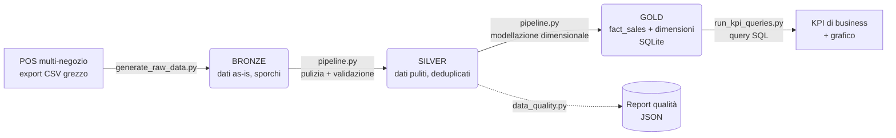

# Retail ELT Pipeline — Medallion Architecture

Pipeline ELT end-to-end che trasforma dati grezzi e sporchi di vendita retail
(export tipico di un sistema POS multi-negozio) in un modello dimensionale
pronto per il reporting, seguendo l'**architettura Medallion** (Bronze →
Silver → Gold).

Progetto costruito per esercitarmi su data cleaning, data quality,
modellazione dimensionale e SQL su un caso d'uso vicino alla mia esperienza
reale nel retail (gestione punti vendita e analisi KPI).

## Architettura



**Bronze** — dati grezzi, identici alla fonte. Contengono volutamente:
prezzi in formati misti (`49.99`, `49,99€`, vuoto), date in tre formati
diversi (ISO, europeo, timestamp Unix), email cliente con casing
incoerente, categorie con refusi (`Scarpe` / `scarpe ` / `SCARPE`), righe
duplicate e resi (quantità negative) mischiati alle vendite.

**Silver** — dati normalizzati, deduplicati, con controlli di qualità
espliciti e tracciabili (vedi `src/data_quality.py`). Ogni riga scartata
o corretta è conteggiata nel report, non "sparisce" silenziosamente.

**Gold** — modello dimensionale a stella (`fact_sales` + `dim_product`,
`dim_store`, `dim_date`) in SQLite, interrogabile con SQL puro per
calcolare KPI di business.

## Struttura del repository

```
retail-elt-pipeline/
├── src/
│   ├── generate_raw_data.py   # genera i dati grezzi sporchi (Bronze)
│   ├── data_quality.py        # controlli di qualità riusabili
│   ├── pipeline.py             # orchestratore Bronze -> Silver -> Gold
│   └── run_kpi_queries.py     # query SQL di business + grafico
├── tests/
│   └── test_data_quality.py   # test automatici (pytest)
├── data/
│   ├── bronze/                 # dati grezzi
│   ├── silver/                 # dati puliti
│   └── gold/                   # retail.db (SQLite, modello dimensionale)
├── reports/
│   ├── data_quality_report.json
│   ├── kpi_summary.json
│   ├── monthly_revenue.png
│   └── pipeline_run.log
└── requirements.txt
```

## Come eseguirlo

```bash
pip install -r requirements.txt

cd src
python generate_raw_data.py   # genera i dati grezzi (Bronze)
python pipeline.py            # esegue Bronze -> Silver -> Gold
python run_kpi_queries.py     # calcola i KPI ed esporta il grafico

cd ..
pip install pytest
pytest tests/ -v              # esegue i test sui controlli di qualità
```

## Risultati di esempio (su 6.126 transazioni grezze generate)

| Metrica | Valore |
|---|---|
| Righe grezze (Bronze) | 6.126 |
| Duplicati rimossi | 126 |
| Righe scartate per dati critici mancanti | 199 |
| Righe pulite (Silver/Gold) | 5.801 |
| Controlli di data quality superati | 5/5 |
| Fatturato netto totale | € 724.220,44 |
| Tasso di reso | 5,21% |
| Categoria più venduta | Scarpe (€ 415.918,07) |

Il dettaglio completo per negozio, prodotto e periodo è nei file
`reports/kpi_summary.json` e `reports/monthly_revenue.png`.

## Query SQL di esempio (modello dimensionale)

```sql
SELECT p.product_name, p.category,
       ROUND(SUM(f.net_revenue), 2) AS net_revenue,
       SUM(f.quantity) AS units_sold
FROM fact_sales f
JOIN dim_product p ON f.product_key = p.product_key
GROUP BY p.product_name, p.category
ORDER BY net_revenue DESC
LIMIT 5;
```

Altre query (fatturato per negozio, weekend vs feriale, tasso di reso)
sono in `src/run_kpi_queries.py`.

## Cosa dimostra questo progetto

- Progettazione e implementazione di una pipeline ELT a livelli (Bronze/Silver/Gold)
- Data cleaning e normalizzazione di formati eterogenei (date, prezzi, testo)
- Controlli di data quality espliciti, tracciabili e testati
- Modellazione dimensionale (schema a stella) e interrogazione SQL
- Logging strutturato dell'esecuzione della pipeline
- Test automatici sulla logica di validazione

## Limiti dichiarati

Pipeline eseguita in locale su SQLite per semplicità didattica: non
include orchestrazione (es. Airflow), storage cloud (S3) o esecuzione
distribuita. È pensata come dimostrazione dei concetti di data
cleaning, data quality e modellazione dimensionale, non come sistema
production-ready su larga scala.
